<!-- ======================= HERO BANNER ======================= -->
<p align="center">
  <picture>
    <source media="(prefers-color-scheme: dark)" srcset="./dark.svg">
    <source media="(prefers-color-scheme: light)" srcset="./light.svg">
    
  </picture>
</p>

<p align="center">
  <a href="https://www.abdulhannan.online"></a>
  <a href="https://www.linkedin.com/in/abdul-hannan321/"></a>
  <a href="https://www.upwork.com/freelancers/abdulh699"></a>
  <a href="mailto:se.abdulhannan@gmail.com"></a>
</p>

---

## 👋 About

```text
"Code is a tool, but performance is the product."
```

I'm **Abdul Hannan**, a Full-Stack Engineer based in Pakistan. I help businesses move
away from slow, generic templates toward **custom-coded, high-performance web systems** —
combining the precision of a software engineer with an eye for clean, usable interfaces.
I work across the stack, from data models and APIs to the pixels users actually touch,
and I care about security, scalability, and speed in equal measure.

- 🧩 **Full-stack** across MERN, PERN, Java Spring, .NET & Django
- 🛒 **WordPress & e-commerce** — Elementor, Shopify, WooCommerce, BigCommerce
- ⚡ **Performance-first** — 100+ page sites loading in under 2s with 90+ PageSpeed scores
- 🎓 **BS Computer Science**, University of Engineering & Technology (UET), Peshawar

---

## 🧭 What I'm Building

**A complete multi-platform booking ecosystem** for a UAE service business — website,
iOS & Android apps, and an internal CRM, all powered by **one backend and a single
shared database**. It isn't four separate apps: every frontend is a client of the same
API, so each booking lands in one place and the CRM shows a unified, real-time view with
no syncing, each booking tagged by its source.

| Layer | Status | Built with |
|---|---|---|
| Booking Platform | ✅ Built | React |
| Mobile Apps — iOS & Android | 🚧 In development | Flutter (Dart) · Riverpod |
| CRM / Admin Dashboard | ✅ Built | React · role-based access |
| Backend + Database | ✅ Built | Node.js · Express · Prisma · MySQL |

> Gateway-agnostic payments (swap providers via config), API-only mobile access for
> security, and a live service/price admin panel whose edits propagate instantly.

---

## 💼 Experience

**Full-Stack Developer** — *5X Digital, Islamabad* · May 2025 – Present
Lead development for national and international clients; revamped dozens of websites
and helped lift monthly traffic significantly alongside the team.

**WordPress Developer** — *US Digital Marketing, Las Vegas* · 2025
Rebuilt 5 websites across different teams, growing monthly impressions to 54.9K+ and
2.5K+ clicks, while coordinating developers and SEO specialists to ship on time.

---

## 🚀 Featured Projects

- **Booking Ecosystem** — Web + iOS/Android + CRM on a single Node/Prisma/MySQL backend.
- **FerozVisa Consultancy** — Next.js marketing website for a visa consultancy.
- **BMT Services LLC** — WordPress business website.
- **Voguenthreads** — AI-based measuring system delivered as a custom Shopify app.
- **Imperiastitch** — Custom post-selection user journey built as a WordPress plugin.

---

## 🛠️ Engineering Stack

**Languages**


**Backend & Frameworks**


**Frontend**


**Databases & DevOps**


**CMS & E-commerce**


---

## 📊 GitHub Activity

<p align="center">
  
  
</p>

---

## ✍️ Content

I also share build content and development notes:

- **YouTube** — [@abdulhannan_se](https://youtube.com/@abdulhannan_se)
- **Instagram** — [@lock2build](https://www.instagram.com/lock2build/)

---

## 🤝 Connect

Let's build or optimize something real.

- 🌐 Portfolio — [abdulhannan.online](https://www.abdulhannan.online)
- 💻 GitHub — [AbdulHannnan](https://github.com/AbdulHannnan)
- 💼 LinkedIn — [abdul-hannan321](https://www.linkedin.com/in/abdul-hannan321/)
- 📈 Upwork — [freelancers/abdulh699](https://www.upwork.com/freelancers/abdulh699)
- ✉️ Email — [se.abdulhannan@gmail.com](mailto:se.abdulhannan@gmail.com)

<sub>⭐ Banner is a self-contained animated SVG (SMIL only, no JavaScript) with a theme-aware dark/light variant.</sub>
